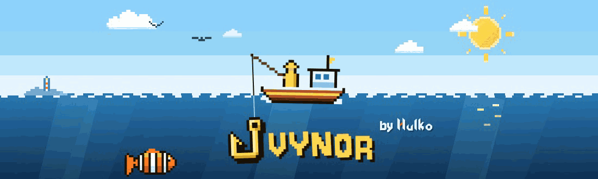
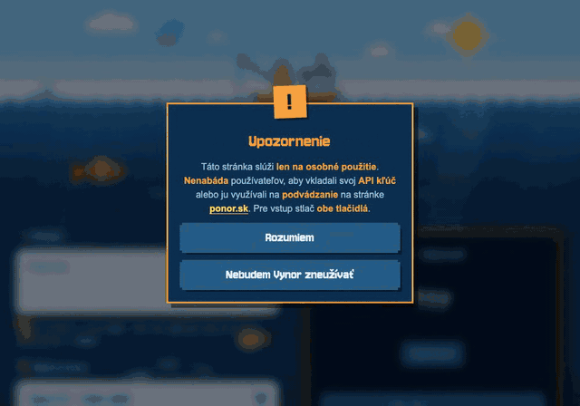
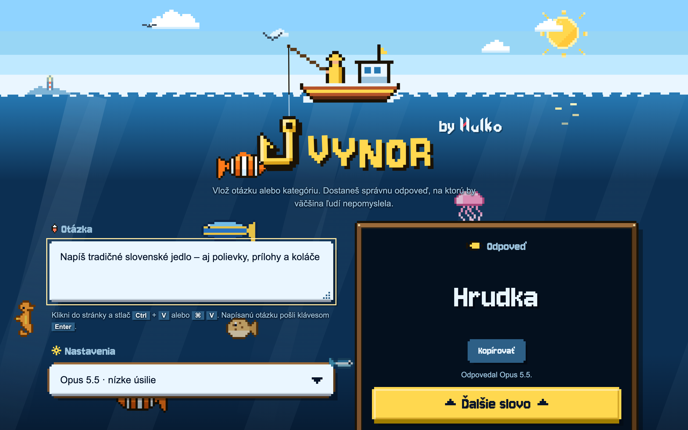
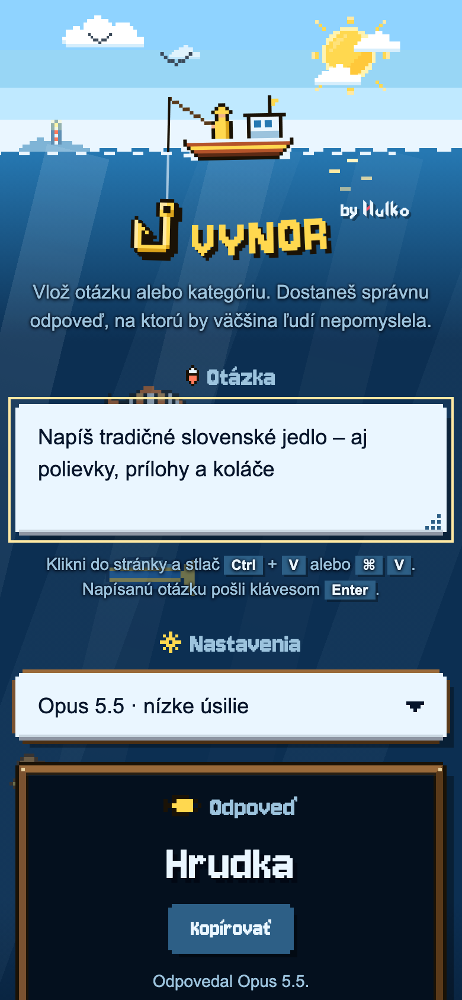

<p align="center"></p>

<h1 align="center">Vynor by Hulko</h1>

**Vynor nájde odpovede, na ktoré nikto iný nepomyslí.** Vlož slovenskú otázku alebo kategóriu a Claude vráti jedno slovo. To slovo je správne, ale nezvyčajné, a práve také boduje v [PONORe](https://ponor.sk), slovenskej slovnej hre, kde samozrejmé odpovede nezískajú nič.

> *Napíš tradičné slovenské jedlo* → **Hrudka** (nie *bryndzové halušky*)



| Počítač | Mobil |
| --- | --- |
|  |  |

## Funkcie

- **Vlož a hotovo:** stlač Ctrl/⌘ V kdekoľvek na stránke a odpoveď príde hneď. Napísanú otázku pošleš klávesom Enter.
- **Ďalšie slovo** vypýta inú odpoveď a vynechá tie, ktoré už boli zobrazené.
- **Nastavenia:** vyber model (Opus, Sonnet alebo Haiku 5.5) a úsilie (nízke, stredné alebo vysoké). Voľby si stránka zapamätá.
- Pixelový oceán inšpirovaný ponor.sk, s vlastnou grafikou. Ak zariadenie žiada obmedzený pohyb, všetky animácie sa vypnú.

## Spustenie

Celá aplikácia je jeden súbor, `index.html`, a nič sa nezostavuje. Ten istý súbor beží na dvoch miestach:

- **Ako artefakt na claude.ai:** Claude odpovedá cez schopnosť artefaktu `sample`, takže API kľúč netreba.
- **Na vlastnej doméne [vynor.hulko.xyz](https://vynor.hulko.xyz):** návštevníci zadajú vlastný Anthropic API kľúč. Ostáva v localStorage ich prehliadača a posiela sa iba na `api.anthropic.com`.

Vlastnú kópiu nasadíš príkazom:

```sh
./deploy.sh
```

Ten nasadí Cloudflare Worker `vynor` z dočasného priečinka, v ktorom je len stránka, `_headers` (bezpečnostná politika obsahu), favicon, písmo a pribalené SDK. Nespúšťaj v tomto priečinku samotné `wrangler deploy`: zverejnilo by všetko, čo v ňom je.

## Súbory projektu

| Súbor | Čo to je |
| --- | --- |
| `index.html` | aplikácia: kód stránky, štýly, skript a prompt |
| `anthropic-sdk.js` | pribalená kópia Anthropic SDK pre stránku na vlastnej doméne |
| `_headers` | bezpečnostné hlavičky (deploy.sh doplní do politiky obsahu hash skriptu) |
| `DESIGN.md`, `PRODUCT.md` | dizajnový systém a poznámky k produktu |

---

Len na osobné použitie. Vynor nenabáda k vkladaniu API kľúča ani k podvádzaniu na ponor.sk.
